# Terraform AWS 3-Tier Architecture


A modular Terraform project that builds a 3-tier network on AWS: a VPC with public and private subnets across two Availability Zones and a web tier of EC2 instances, plus optional NAT, load balancer, application tier and PostgreSQL tiers that you switch on with feature flags. Instances are managed through **AWS Systems Manager Session Manager**, so there is no SSH port and no key pair.

## Screenshots

### Terraform Initialization

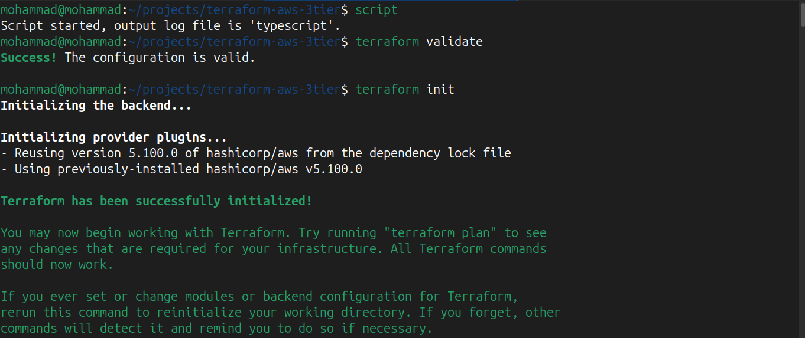

### Terraform Plan

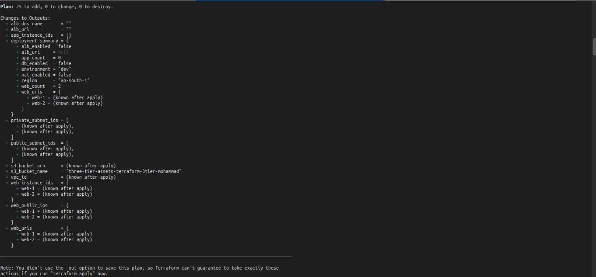

### Terraform Resources

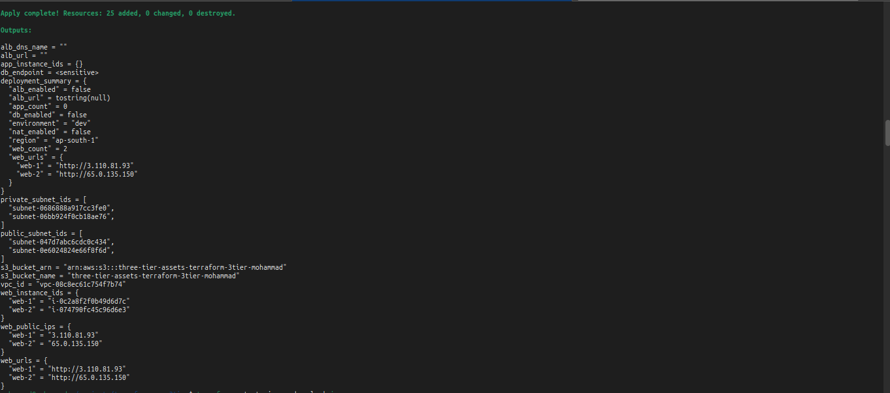

### Curl Output

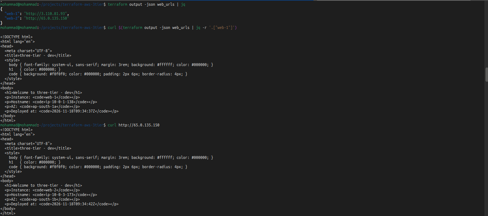

### SSM Session

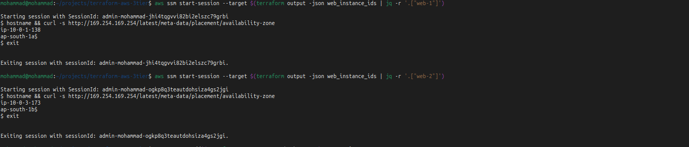

### Web Results

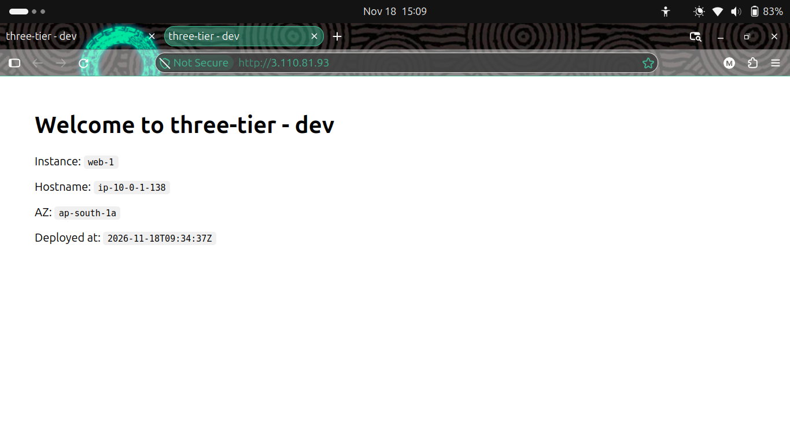
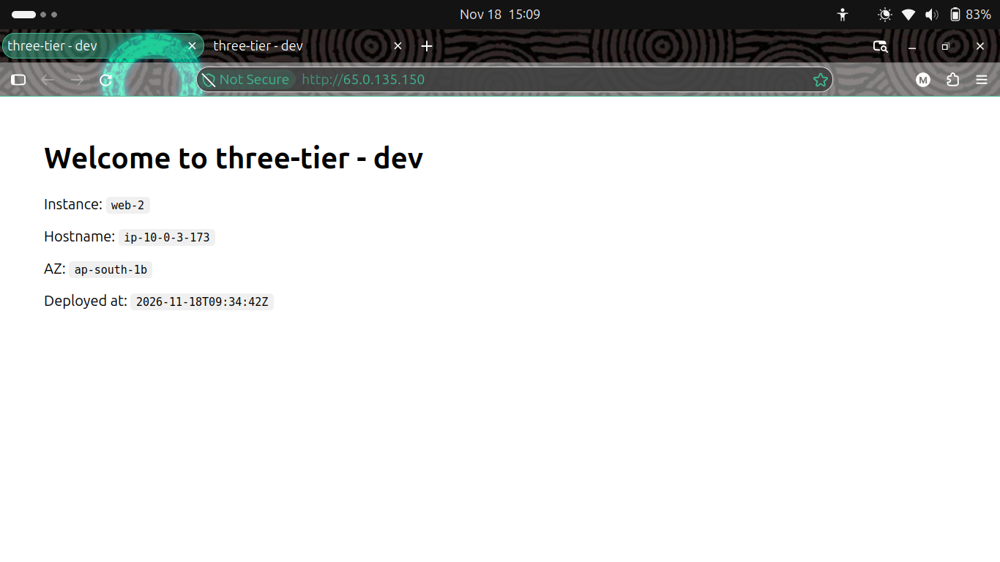

### IAM Role SSM Policy

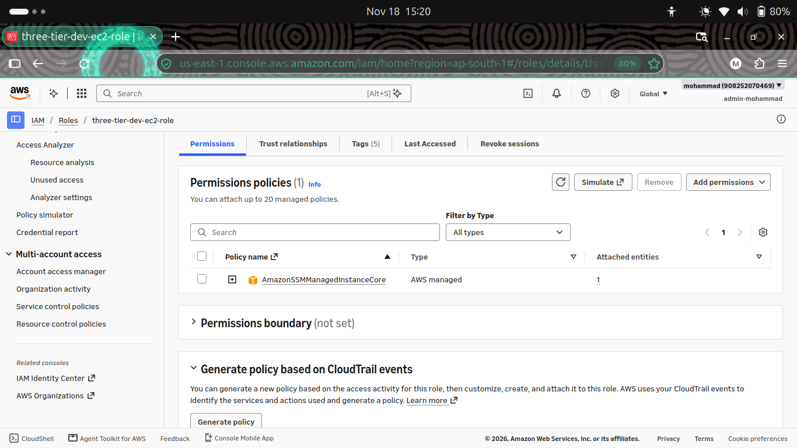

### Security Group http Only

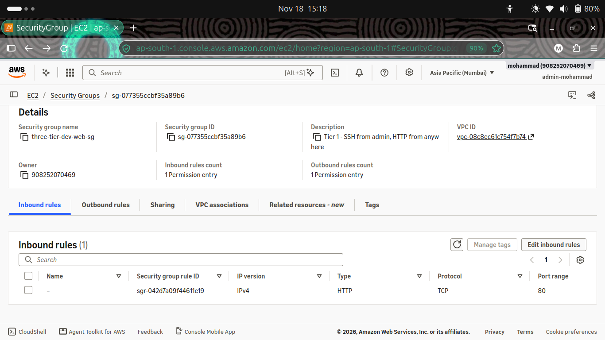

### VPC Subnets

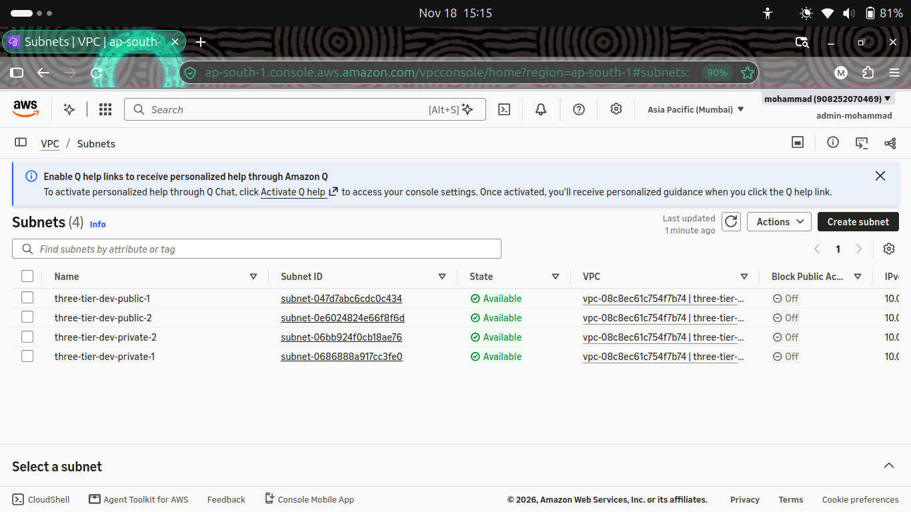


## What was deployed and verified

The recorded run used the default configuration (web tier only) in `ap-south-1`:

| Check | Result |
|---|---|
| `terraform validate` and `init` | Passed |
| `terraform plan` | 25 to add, 0 to change, 0 to destroy |
| `terraform apply` | 25 resources added |
| Web instances answer over HTTP | `web-1` in `ap-south-1a`, `web-2` in `ap-south-1b` |
| Shell access without SSH | SSM sessions opened on both instances |
| `terraform destroy` | 25 resources destroyed | 

The full cleaned terminal log is in [`docs/typescript`](docs/typescript). The infrastructure was destroyed after testing, so the IPs in the screenshots no longer exist.

## Architecture

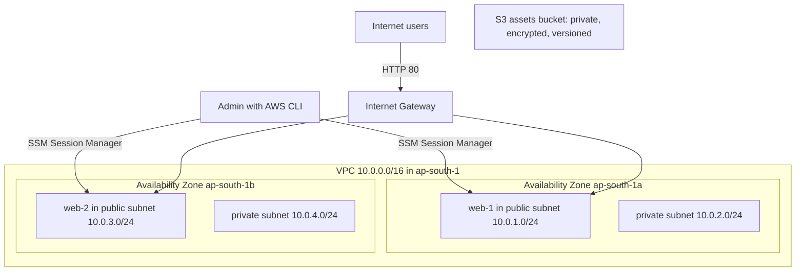

Private subnets exist in every run. They hold the optional application and database tiers when those flags are on.

## What gets created

**Always created (25 resources in the recorded run)**

| Area | Resources |
|---|---|
| Network | VPC, internet gateway, 2 public subnets, 2 private subnets, 1 public route table, 2 private route tables, 4 route table associations |
| Security | Web security group (HTTP 80 from anywhere, no SSH rule) |
| Identity | EC2 IAM role with `AmazonSSMManagedInstanceCore`, role attachment and instance profile |
| Compute | 2 web instances (Ubuntu 22.04, `t3.micro`, 20 GB encrypted gp3 root volume) running nginx through user data |
| Storage | S3 bucket with versioning, AES256 encryption, public access block, TLS-only policy and a lifecycle rule for old versions |

**Optional, off by default.** These exist in the code but were **not** deployed in the recorded run.

| Flag | Adds | Cost note |
|---|---|---|
| `enable_nat_gateway` | Elastic IP, NAT gateway and a default route for each private subnet | About $32 per month per AZ |
| `enable_alb` | Application Load Balancer, target group, listener and attachments | About $16 per month |
| `enable_app_tier` | App instances in private subnets and an app security group (port 8080 from the web security group only) | Needs NAT for package updates |
| `enable_db_tier` | RDS PostgreSQL 16 in private subnets, encrypted, not publicly accessible, reachable only from the app security group | About $15 to 20 per month |

## Design decisions

- **SSM instead of SSH.** No inbound port 22, no key pair to lose or rotate. Access is controlled by IAM and logged by AWS. [Security group](docs/AWS_SGs.png) and [IAM role](docs/AWS_roles.png) screenshots show the result.
- **Feature flags for cost.** The expensive tiers (NAT, ALB, RDS) are off by default so a demo run stays cheap.
- **Stable `for_each` keys.** Instances are keyed `web-1`, `web-2`, so changing the count adds or removes only the affected instance instead of re-creating the others.
- **Security group chaining.** The app tier accepts traffic only from the web security group, and the database accepts traffic only from the app security group.
- **Hardened S3 bucket.** Versioning, server-side encryption, all public access blocked, a policy that denies non-TLS requests, and expiry of old object versions after 30 days (configurable).
- **Encrypted storage.** Root volumes and the optional RDS instance have encryption enabled.
- **Validated inputs.** `environment` must be `dev`, `staging` or `prod`, at least one web instance is required, and a supplied database password must be at least 12 characters.
- **Consistent tagging.** Every resource carries `Project`, `Environment`, `ManagedBy` and `Owner` tags through one `locals` block.

## Getting started

**Prerequisites:** Terraform 1.5 or newer, AWS CLI v2 configured with credentials that can create these resources, and the [Session Manager plugin](https://docs.aws.amazon.com/systems-manager/latest/userguide/session-manager-working-with-install-plugin.html) for the AWS CLI.

```bash
git clone https://github.com/<your-username>/terraform-aws-3tier.git
cd terraform-aws-3tier

cp terraform.tfvars.example terraform.tfvars
# edit terraform.tfvars: set bucket_name_suffix to a globally unique value

terraform init
terraform plan
terraform apply

terraform output web_urls
curl "$(terraform output -json web_urls | jq -r '.["web-1"]')"

# shell access without SSH
aws ssm start-session --target "$(terraform output -json web_instance_ids | jq -r '.["web-1"]')"

# clean up
terraform destroy
```

**Inputs you are most likely to change**

| Variable | Default | Purpose |
|---|---|---|
| `aws_region` | `ap-south-1` | Region |
| `environment` | none (required) | `dev`, `staging` or `prod` |
| `web_instance_count` | `2` | Number of web servers |
| `instance_type` | `t3.micro` | Instance size |
| `bucket_name_suffix` | none (required) | Makes the S3 bucket name globally unique |
| `enable_nat_gateway`, `enable_alb`, `enable_app_tier`, `enable_db_tier` | `false` | Optional tiers |

Never commit `terraform.tfvars` or any `*.tfstate` file. The database password, when you enable that tier, should come from `TF_VAR_db_password`.

## Project structure

```
.
├── main.tf              # providers, AMI and AZ lookups
├── vpc.tf               # VPC, subnets, route tables, optional NAT
├── security.tf          # security groups for each tier
├── iam.tf               # EC2 role and instance profile for SSM
├── compute.tf           # web and app instances, optional ALB and RDS
├── storage.tf           # hardened S3 bucket
├── locals.tf            # names, tags, instance maps
├── variables.tf         # inputs and validation
├── outputs.tf           # URLs, IDs and a deployment summary
├── templates/           # user data for the web and app tiers
├── policies/ssh.rego    # OPA policy that flags open SSH
├── backend.tf.disabled  # example remote state backend
└── docs/                # screenshots and terminal log
```

## Known limitations

These are listed on purpose, so you can see what this project does not claim.

- **The optional tiers were not deployed in the recorded run.** NAT, ALB, the app tier and RDS exist in the code but are untested here.
- **Web instances have public IPs and serve plain HTTP.** There is no HTTPS yet.
- **Private app instances need a route to the SSM service.** Enable NAT or add VPC endpoints, otherwise sessions to them will not start.
- **The RDS instance is single-AZ and uses a password variable.** Multi-AZ and a Secrets Manager managed password are not configured.
- **IMDSv2 is not enforced** on the instances, and the database security group still allows all outbound traffic.
- **The security group description still says "SSH from admin."** It was written before the move to SSM. There is no SSH rule, as the [security group screenshot](docs/images/09-security-group-http-only.png) shows.
- **State is local by default.** `backend.tf.disabled` shows an S3 backend, which uses `use_lockfile` and so needs a newer Terraform than the `>= 1.5` declared in `main.tf`.
- **`policies/ssh.rego` has not been run yet** and is not wired into CI.

## Next steps

- [ ] Run the Rego policy with Conftest against a plan and add it to CI
- [ ] Add a GitHub Actions workflow: `terraform fmt -check`, `validate`, `tflint` and a security scan
- [ ] Enforce IMDSv2, add HTTPS, and move the database password to a managed secret
- [ ] Deploy and screenshot the optional tiers once, then destroy them
- [ ] Split the network and compute code into reusable modules

## Author

**Maaz**
GitHub: [@rulesmaaz-spec](https://github.com/rulesmaaz-spec) ·v
LinkedIn: www.linkedin.com/in/mohammad-maaz-805880402 · Email: mohammadmaaz90779@gmail.com
Built as part of my DevOps journey.

## License

MIT
